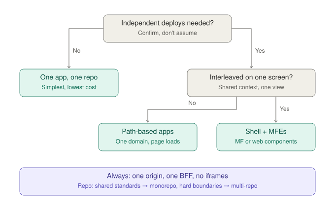
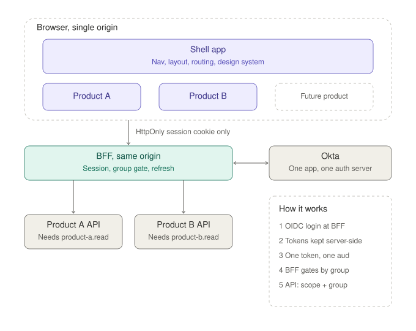
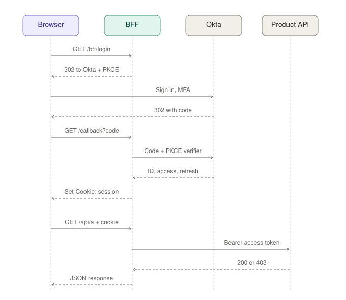
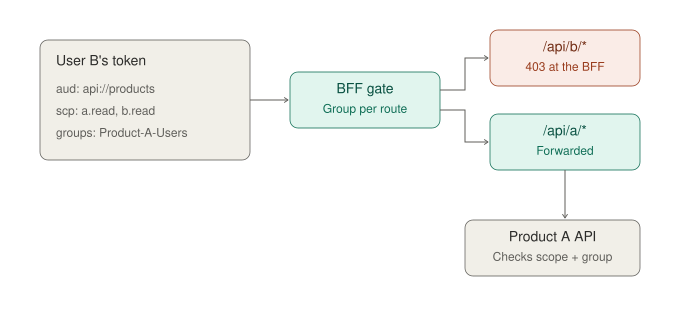
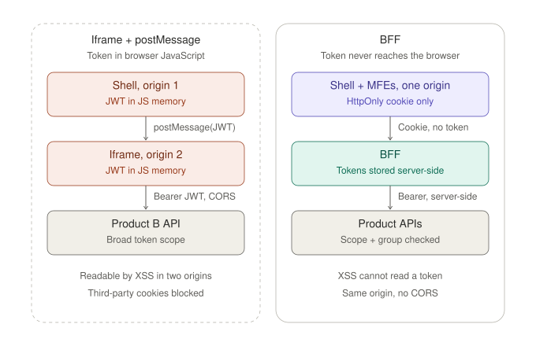
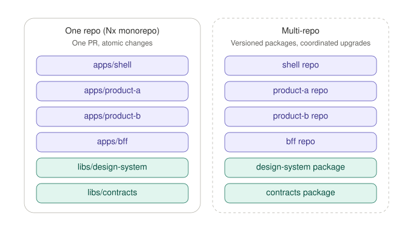
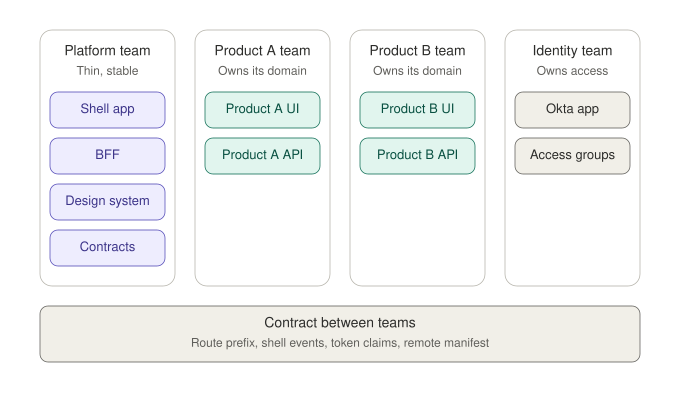

# Frontend composition: shell, micro-frontends and BFF

Proposal for running two products side by side behind one shell, with a Backend for Frontend (BFF) handling authentication.

**Assumption:** one Okta app and one custom authorization server. Products are separated by **scopes** (which API the client may call) and **groups** (which product the user may use). If the products sit on separate Okta apps or tenants, token exchange is required and complexity increases.

## 1. Which option fits?

Independent deployment is the only strong reason for micro-frontends. If it isn't needed, one app in one repo is the simplest choice.

## 2. Target architecture

- One origin, one BFF. The browser holds only an HttpOnly session cookie.
- The BFF calls the product APIs directly. APIM is optional and only needed if the APIs have other consumers or policy requires it.

## 3. Login and first API call

Standard OIDC authorization code flow with PKCE. The BFF is a confidential client, tokens are stored server-side, and refresh happens server-side.

## 4. Access enforcement

- Okta does not partially grant scopes. Every token carries both scopes, and the `groups` claim decides user access.
- The BFF rejects requests early; each API still validates the token, scope and group (defence in depth).

## 5. Why not iframes

Passing a JWT through postMessage, or an encrypted token decrypted by another team's API, puts a bearer token in browser JavaScript or creates runtime coupling between teams. Neither is needed once both products share an origin and a BFF.

## 6. One repo vs multi-repo

The runtime architecture is the same either way. The repo choice only changes how shared code (design system, contracts) is distributed: direct imports or versioned packages.

## 7. Proposed ownership

Keep the shell and BFF thin and owned by a neutral team. Product teams own their own domains, and the identity team owns access.
